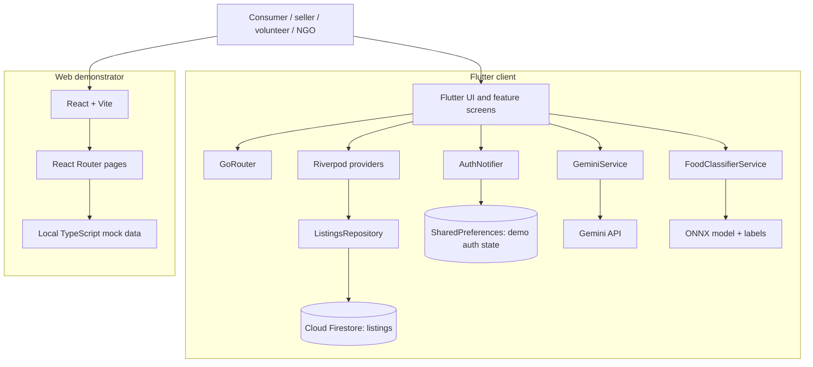

# Annva (अन्नवा) — Food That Moves

Annva is a food-rescue platform concept that connects surplus food from restaurants, bakeries, kirana stores, and events with consumers, volunteers, and NGO partners. This repository currently contains **two separate client implementations**: a Flutter/Dart app and a React/Vite web demonstrator.

> **Project status:** Prototype / MVP. Firebase listing integration and mobile ML inference code are present in the Flutter app. Several dashboards and interactions in the React web app use local mock data. Do not assume every screen or button represents a production-connected workflow.

## Contents

- [Features](#features)
- [Technology stack](#technology-stack)
- [Architecture](#architecture)
- [Repository layout](#repository-layout)
- [Prerequisites](#prerequisites)
- [Setup](#setup)
- [Configuration and secrets](#configuration-and-secrets)
- [Sample data](#sample-data)
- [Testing](#testing)
- [Troubleshooting](#troubleshooting)
- [License](#license)

## Features

- Food listings with seller, locality, dietary tags, quantity, servings, original/current prices, expiry, and cascade stage.
- Role-oriented experiences for consumers, sellers, volunteers, and NGOs.
- A location/map view for finding rescue opportunities.
- Flutter state providers for listings, cart, and price locks.
- Impact metrics, seller/giver directory, event page, and role dashboards in the web demo.
- Firestore-backed listing streams in Flutter.
- Gemini-powered “Smart Rescue Card” content generation from listing details.
- Image-based food classification using ONNX Runtime on supported non-web Flutter platforms.

Some screens use placeholder controls, local demo state, mock users, and illustrative impact figures. Verify individual flows before presenting them as live functionality.

## Technology stack

### Flutter application

- Flutter and Dart (the package manifest requests Dart SDK `^3.11.0`)
- Riverpod 2 and Riverpod code generation for state management
- GoRouter for navigation
- Firebase Core, Cloud Firestore, Realtime Database, and Firebase Messaging packages
- `google_generative_ai` and `flutter_dotenv` for Gemini integration and environment configuration
- ONNX Runtime and the `image` package for food-image classification
- `freezed` and `json_serializable` for model generation
- `flutter_map` and `latlong2` for maps

**Authentication note:** the inspected `AuthNotifier` currently simulates OTP verification and persists a role/phone/user ID with `SharedPreferences`. The checked-in `pubspec.yaml` does not declare the `firebase_auth` package, so this should not be described as production Firebase Authentication without further implementation.

### React web demonstrator

- React 18, TypeScript, Vite
- React Router and TanStack React Query
- Tailwind CSS and Radix UI components
- Leaflet / React Leaflet, Recharts, Lucide icons
- Vitest, Testing Library, jsdom, ESLint
- Capacitor packages/configuration are also present for hybrid packaging

## Architecture

### High-level view



The diagram intentionally separates the web demonstrator's local mock-data path from the Flutter listing path that explicitly subscribes to Firestore.

### Flutter request/data flow

1. `lib/main.dart` attempts to load `.env`, initialize Firebase using `DefaultFirebaseOptions`, and configure Firestore persistence before starting the app inside Riverpod's `ProviderScope`.
2. `lib/core/router/app_router.dart` configures GoRouter routes and redirects based on the current `AuthNotifier` state.
3. Feature screens read state from Riverpod providers and use shared models/widgets.
4. `activeListingsProvider` delegates to `ListingsRepository.watchActiveListings()`.
5. `ListingsRepository` watches the Firestore `listings` collection, filters for records marked active whose `expiresAt` is in the future, and sorts them by earliest expiry.
6. `FoodClassifierService` loads `assets/models/annva_model.onnx` and `assets/models/labels.json`, preprocesses an image to 300×300, runs ONNX inference, applies softmax, and returns the top predictions. The current service explicitly rejects web inference.
7. `GeminiService` sends dish/context prompts to Gemini 1.5 Flash, caches successful or fallback results by listing ID for the current process session, and returns fallback fields if generation or JSON parsing fails.

Firebase initialization errors are caught in `main.dart`, after which the app still attempts to start. If cloud features fail, inspect logs and verify Firebase setup instead of assuming the connection succeeded.

### Web flow

- `src/main.tsx` mounts `src/App.tsx`.
- `src/App.tsx` configures React Query, tooltip/toast providers, and React Router.
- Routes include `/`, `/map`, `/consumer`, `/seller`, `/volunteer`, `/ngo`, `/givers`, `/impact`, and `/events`.
- Dashboard pages import records from `src/data/mock.ts`. Most values and metrics there are showcase data; the web route flow inspected does not establish that these actions persist to Firebase.

## Repository layout

Selected paths (generated files and native build boilerplate omitted):

```text
.
├── assets/
│   ├── fonts/
│   └── models/
│       ├── annva_model.onnx
│       ├── annva_model.onnx.data
│       └── labels.json
├── lib/                         # Flutter/Dart application
│   ├── core/
│   │   ├── router/
│   │   ├── services/            # Gemini integration
│   │   └── theme/
│   ├── features/
│   │   ├── auth/
│   │   ├── consumer/
│   │   ├── demo/                # Mock data and optional Firestore seeder
│   │   ├── impact/
│   │   ├── ngo/
│   │   ├── seller/
│   │   └── volunteer/
│   ├── shared/
│   │   ├── models/
│   │   ├── providers/
│   │   ├── repositories/
│   │   └── widgets/
│   ├── main.dart
│   └── firebase_options.dart
├── test/                        # Flutter tests
├── src/                         # React/TypeScript web demonstrator
│   ├── components/
│   ├── data/mock.ts
│   ├── pages/
│   └── test/
├── android/                     # Android project
├── ios/                         # iOS project
├── web/                         # Flutter web assets/configuration
├── pubspec.yaml
├── package.json
├── vite.config.ts
├── vitest.config.ts
├── firebase.json
└── README.md
```

## Prerequisites

Install only the toolchain for the client you intend to run.

**Flutter app:** Flutter stable compatible with Dart `^3.11.0`, Android Studio or Xcode for native targets, and a configured emulator/device. Run `flutter doctor` to check your environment.

**React web app:** Node.js compatible with the package lock and Vite 5, plus npm. Bun lockfiles are also present; use one package manager consistently to avoid dependency/lockfile drift.

Firebase-backed functionality requires access to a Firebase project with the relevant services enabled. Gemini-backed features require a Gemini API key.

## Setup

Clone the repository:

```bash
git clone https://github.com/jai8806/annvagdg.git
cd annvagdg
```

### A. Run the Flutter app

1. Install Dart/Flutter dependencies:

   ```bash
   flutter pub get
   ```

2. Create a local `.env` in the repository root. The tracked `.env.example` documents the expected variable:

   ```dotenv
   GEMINI_API_KEY=your_gemini_api_key
   ```

3. Configure Firebase for a project you control. Review `lib/firebase_options.dart`, `firebase.json`, and the Android Google Services configuration. Prefer regenerating platform options with the FlutterFire CLI rather than blindly reusing another project's configuration. Enable the Firebase services the app uses and configure database security rules.

4. Check the connected devices and run the app:

   ```bash
   flutter devices
   flutter run
   ```

5. Run static analysis and tests:

   ```bash
   flutter analyze
   flutter test
   ```

Notes:

- `pubspec.yaml` declares `.env`, model files, and fonts as Flutter assets; keep the referenced paths present at build time.
- The ONNX classifier is mobile/native only in the current implementation and throws `UnsupportedError` on web.
- `lib/features/demo/firestore_seeder.dart` **deletes every document** in the Firestore `listings` collection before inserting demo listings. Do not run it against a production or shared dataset. Use an isolated Firebase test project or change the seeder to target a dedicated demo collection first.

### B. Run the React/Vite web demonstrator

1. Install dependencies:

   ```bash
   npm ci
   ```

   Alternatively, use Bun consistently if that is your project workflow.

2. Start the development server:

   ```bash
   npm run dev
   ```

3. Open the local URL printed by Vite. `vite.config.ts` sets port `8080` by default.

4. Build and preview the production bundle:

   ```bash
   npm run build
   npm run preview
   ```

5. Run unit tests and lint:

   ```bash
   npm test
   npm run lint
   ```

The checked-in `capacitor.config.json` also contains a hosted `server.url`. If using Capacitor for a local packaged build, review that setting and `webDir` so the package points to the intended local build rather than an unintended hosted instance.

## Configuration and secrets

| Variable / file | Purpose | Guidance |
|---|---|---|
| `.env` | Flutter reads `GEMINI_API_KEY` using `flutter_dotenv` | Create locally; never commit real API keys |
| `.env.example` | Documents the Gemini key variable | Contains a placeholder, not a working key |
| `lib/firebase_options.dart` | FlutterFire platform client options | Regenerate for the Firebase project you control |
| `android/app/google-services.json` | Android Firebase configuration | Use the matching project config and review repository-sharing implications |
| `assets/models/annva_model.onnx` and `.data` | Food classifier model and external tensor data | Keep both paired and packaged |
| `assets/models/labels.json` | Maps output indices to class labels | Must stay aligned with the trained model's output order |

Firebase client configuration is not a substitute for authorization. Protect Firestore and Realtime Database using appropriate security rules, enforce roles/permissions server-side or in rules, and restrict API usage where applicable. Never commit service-account credentials or server-side secrets.

## Sample data

Sample/demo data is defined in `lib/features/demo/mock_data.dart`, `lib/features/demo/firestore_seeder.dart`, and `src/data/mock.ts`. The examples below are illustrative, not current inventory. Dates and listing availability should be generated/validated at runtime for real use.

### Food listing schema (Flutter)

| Field | Type | Description |
|---|---|---|
| `id` | string | Listing identifier |
| `name` | string | Food or batch name |
| `sellerId`, `sellerName` | string | Seller reference and display name |
| `vertical` | string | For example, Restaurant, Bakery, Kirana, or Event |
| `address` | string | Pickup locality/address label |
| `diet` | string array | Dietary tags, for example `veg` |
| `qtyKg` | number | Quantity in kilograms |
| `servings` | integer | Approximate servings |
| `originalPrice`, `currentPrice` | integer | Prices in INR |
| `stage` | enum/string | Cascade stage; serialized values are `fresh`, `good_deal`, `hot_deal`, `last_call`, `ngo` |
| `expiresAt`, `createdAt` | timestamp | Expiry and creation times |
| `lat`, `lng` | number | Pickup coordinates |
| `imageUrl` | string | Image URL or an emoji in demo data |
| `isActive` | boolean | Whether the listing is active |
| `lockedPrice`, `lockedUntil`, `lockedByUserId` | optional | Price-lock state |

### Example listing JSON

```json
{
  "id": "SAMPLE-001",
  "name": "Vegetable thali",
  "sellerId": "seller-demo-01",
  "sellerName": "Demo Restaurant",
  "vertical": "Restaurant",
  "address": "Central Bengaluru",
  "diet": ["veg"],
  "qtyKg": 8.0,
  "servings": 32,
  "originalPrice": 2400,
  "currentPrice": 1200,
  "stage": "hot_deal",
  "expiresAt": "2030-01-01T17:00:00Z",
  "lat": 12.9716,
  "lng": 77.5946,
  "imageUrl": "🍱",
  "createdAt": "2030-01-01T13:00:00Z",
  "isActive": true
}
```

This example is for documentation and tests; it is **not** a ready-to-import Firestore export. The model's generated JSON serializer expects Firestore `Timestamp` values for these timestamp fields when interacting with Firestore. Use values matching `CascadeStage` serialization when creating fixtures.

### Web demo records

`src/data/mock.ts` defines `LISTINGS`, `SELLERS`, `VOLUNTEERS`, `NGOS`, tier requirements, and `LIVE_IMPACT`. The 12 sample listings are Bangalore-centric and include dish, seller, vertical, dietary tags, quantity, price, urgency stage, time remaining, and coordinates. These are mock records and their impact totals/names should not be reported as verified real-world results.

### Food-classifier labels

`assets/models/labels.json` contains the class-label list used to interpret ONNX model outputs. It includes labels such as `Chai`, `Idli`, `Kulfi`, `Samosa`, `chapati`, `masala_dosa`, `momos`, and `pizza`. Keep the array order synchronized with the model training/export pipeline.

## Testing

### Available commands

| Area | Command | Purpose |
|---|---|---|
| Flutter analysis | `flutter analyze` | Dart diagnostics and lint rules |
| Flutter tests | `flutter test` | Runs tests under `test/` |
| Web unit tests | `npm test` | Runs Vitest once |
| Web test watch mode | `npm run test:watch` | Re-runs Vitest while editing |
| Web lint | `npm run lint` | Runs ESLint |
| Web production build | `npm run build` | Builds the Vite app |

### Tests currently checked in

- `test/widget_test.dart` contains a Flutter widget smoke test that pumps `AnnvaApp` and checks for expected wordmark text.
- `src/test/example.test.ts` contains only a basic truth assertion. It does not exercise application features.

These tests were inspected in the repository but were **not executed while preparing this README**.

### Recommended test cases

| ID | Test case | Expected result |
|---|---|---|
| FL-01 | Parse a valid listing fixture | `FoodListing` fields and enum are decoded correctly |
| FL-02 | Listing has `isActive = false` | Listing is excluded from active listing results |
| FL-03 | Listing has expired | Listing is excluded from `watchActiveListings()` output |
| FL-04 | Several listings have different expiry times | Results are sorted by earliest expiry |
| FL-05 | Gemini returns invalid JSON or throws an error | Fallback data is returned and the UI remains usable |
| FL-06 | Classifier receives undecodable image bytes | Classification returns `null` rather than a prediction |
| FL-07 | Top classifier confidence is at least `0.65` | `shouldAutoFill` evaluates to `true` |
| FL-08 | Classifier is invoked on web | Unsupported behavior is handled by caller/UI |
| WEB-01 | Visit each defined route | Expected page renders; unknown route shows Not Found |
| WEB-02 | Listing feed is empty | UI renders a safe empty state |
| WEB-03 | Listing price is zero | UI shows the free-rescue path without `NaN`/infinite discount values |
| WEB-04 | Narrow/mobile viewport | Navigation and cards remain usable |
| SEC-01 | Unauthenticated or unauthorized database operation | Firebase rules reject access |
| SEC-02 | Seeder runs in an isolated Firebase test project | Only intended test fixtures are modified |

Recommended next step: implement these as proper unit/widget/integration tests, and use Firebase Emulator Suite for security-rule tests. Mock Gemini and Firebase dependencies where possible so unit tests don't require network access or paid API calls.

## Troubleshooting

- **Flutter cannot load `.env`:** create the file at the repository root and set `GEMINI_API_KEY`. `.env` is ignored by Git; do not commit it.
- **Firebase features don't work:** confirm platform options/config files, Firebase project selection, enabled services, authentication approach, and database rules. Startup catches Firebase initialization errors and may continue into the UI.
- **Food classifier fails to initialize:** check that the ONNX model, its `.onnx.data` companion, and labels file are present and correspond to one another. Test on a supported native target.
- **Food classification is unavailable on web:** this is an explicit limitation in the current classifier implementation.
- **Web tests appear green but features are broken:** the current committed Vitest test is only a placeholder assertion; add component and behavior-specific coverage.
- **Vite port 8080 is busy:** stop the conflicting process or change `server.port` in `vite.config.ts`.
- **Unexpected data loss while seeding:** the demo seeder deletes all existing documents from the `listings` collection. Never run it against production/shared data.

## License

The repository's previous README says **“Proprietary — Annva GDG Project.”** No root-level standard open-source `LICENSE` file was present in the repository tree inspected for this update.

Unless the project owners explicitly choose and add a license, treat this code as proprietary and all rights reserved. Do not describe it as MIT, Apache-2.0, or another open-source license without authorization. If the project is intended to be open source, select the intended license, add its complete text in a root `LICENSE` file, and update this section accordingly.

---

Built as an Annva GDG project. [Source repository](https://github.com/jai8806/annvagdg)
